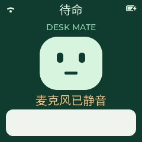

# Desk Mate Cube

Desk Mate Cube is the 240 × 240 variant for the Xingzhi Cube 1.54-inch Wi-Fi board. It has one companion screen: network and device status, a face, confirmed microphone mute state, and the latest conversation subtitle. It does not display a scrolling log.



## Controls

| Control | Action |
| --- | --- |
| BOOT, short press | Start or end a conversation; enter Wi-Fi setup during startup. |
| Volume +, short press | Increase speaker volume by 10. |
| Volume −, short press | Decrease speaker volume by 10. |
| Volume +, hold 1.5 seconds | Cycle screen brightness between 30%, 65% and 100%. |
| Volume −, hold 1.5 seconds | Request microphone mute or unmute from the paired server. The screen shows pending, confirmed, or failed state. |
| Side power/reset control | The manufacturer describes short press to power on and a 5-second hold to power off. Short press while running restarts the connected device; the power-off behavior still needs physical verification on this unit. |

Microphone mute needs a configured control endpoint. Speaker volume 0 and microphone mute are separate controls. A disconnected or unconfigured server cannot confirm a mute request.

## Build

```sh
python3 scripts/build.py nologo/xingzhi-cube-1.54tft-wifi --name desk-mate-cube --language zh-CN
```

The public build defaults to an unusable OTA placeholder. Configure `XIAOZHI_OTA_BASE` or provision `wifi/ota_url` for your own server, and provision a private device pairing token separately. Do not publish paired images or NVS backups. The original `xingzhi-cube-1.54tft-wifi` variant keeps its existing interface and button behavior.

The existing battery power-save and shutdown behavior remains in place. Remote wake while deeply asleep depends on the hardware and power state and requires separate testing. See the [manufacturer's power-button instructions](https://www.nologo.tech/ai/aiproduct/esp32s3ai/esp32s3xiaozhi/esp32s3ai_qa.html).
